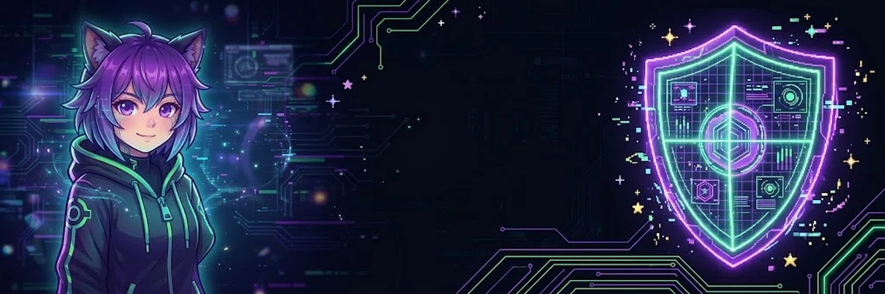

# 🌙 Killer4Reals

<table>
<tr>
<td>

### 🎧 Vibe Coding & AI Automation
🚀 Creator of **K4R Ecosystem**
🤖 Autonomous AI Agents & Media Bots
🔧 Reverse Engineering & Modding
🌙 Building digital empires from scratch.

</td>
<td width="340">

</td>
</tr>
</table>

## 🛠 Projects

| Project | What it does |
|---|---|
| [`K4R-Ecosystem`](https://github.com/Killer4Reals/K4R-Ecosystem) 🔒 | 5 autonomous content bots (Telegram / Shorts / Instagram / TikTok / Dzen): trends → LLM → publish → analytics → monetization, FastAPI dashboards, dry-run by default |
| [`K4R-VPN`](https://github.com/Killer4Reals/K4R-VPN) | VPN-инструментарий K4R |
| [`IIAssist`](https://github.com/Killer4Reals/IIAssist) | K4RCode — Tauri 2 + React + Rust desktop AI-assistant |

---

🌙 *Built at night. Tested by QA-hell.* 🔥

